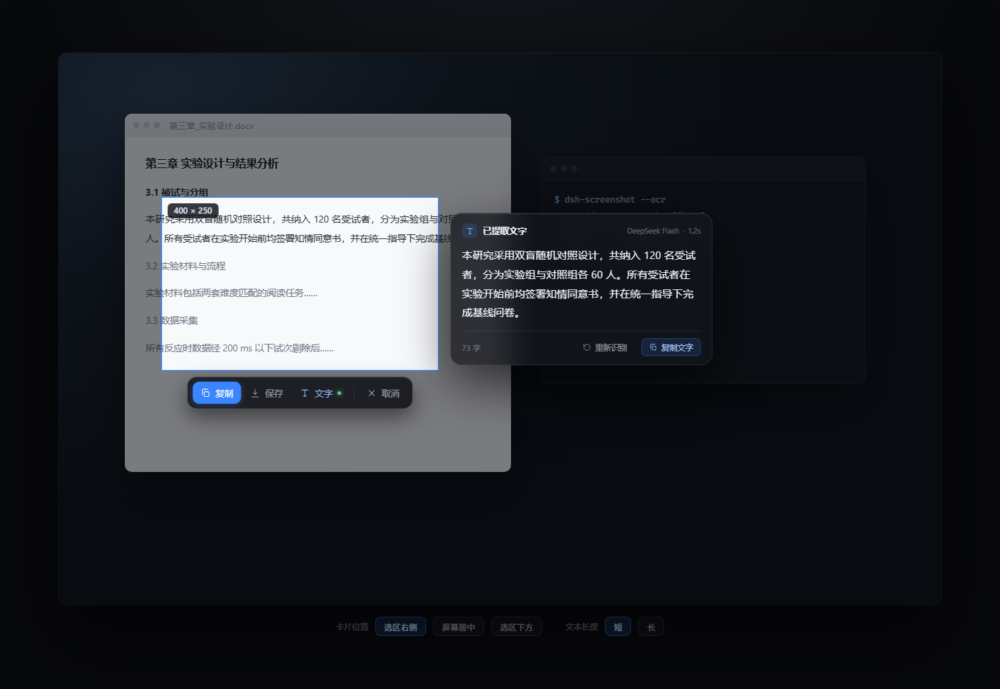

# dsh-screenshot

[](https://www.npmjs.com/package/@zhuyuelei/dsh-screenshot)
[](LICENSE)
[](#已知边界)

无界面（headless）全局快捷键框选截图插件，为 DeepSeek Harness Desktop 编写。
A headless, global-hotkey region screenshot plugin for DeepSeek Harness Desktop: no window,
no sidebar entry, no session — press the hotkey, drag a rectangle, the region is on the
clipboard.

装好之后**不会**新增任何界面：左侧没有入口，对话流里没有卡片，侧栏没有面板。它只做一件事 ——
在任何程序里按下快捷键，屏幕冻结变暗，拖出一个矩形，松手后按 `Enter` 复制到剪贴板，
按 `Esc` 取消。

## 安装

要求 Windows 10/11、DeepSeek Harness Desktop 0.2.x、Node.js 20+。

```powershell
cd "$env:USERPROFILE\.dsh\profiles\desktop"
npm install "@zhuyuelei/dsh-screenshot"
```

包自带 `cordis.patch.yml`（bundle patch），装完把包名追加到同一目录 `package.json` 的
`dsh.profile.bundles` 末尾：

```json
"dsh": {
  "profile": {
    "bundles": [
      "@deepseek-ai/dsh-base",
      "@deepseek-ai/dsh-web-app",
      "@zhuyuelei/dsh-screenshot"
    ]
  }
}
```

重启 DSH，设置 → **截图** 里就有快捷键、保存目录、默认动作和识别模型这五项。想把配置写死
（比如固定用某个快捷键），再在 profile 的 `cordis.patch.yml` 里加一条覆盖：

```yaml
- id: dsh-screenshot
  name: "@zhuyuelei/dsh-screenshot"
  config:
    enabled: true
    hotkey: Ctrl+Alt+A
```

卸载：`npm uninstall @zhuyuelei/dsh-screenshot`，并从 `bundles` 里删掉那一行。
从源码装也是同一条路：`npm install <本仓库路径>`。

## 使用

1. 按下全局快捷键（默认 `Ctrl+Alt+A`）。
2. 拖动鼠标框选区域，松手后出现工具条。
3. 工具条挂在选区**下方**、与选区水平居中（贴着屏幕底边时翻到上方）：
   `复制` 进剪贴板，`保存` 存成 PNG，`文字` 提取文字，`取消` 放弃。
   按住 `Ctrl` 点 `复制`/`保存` 会执行另一个动作。
4. `Esc` 随时取消，`Enter` 执行设置里的默认动作。

### 提取文字（OCR）

点 `TEXT` 后覆盖层显示 `RECOGNIZING`，识别完成后**截图不会消失**：选区、尺寸标签、工具栏
都留在原处，旁边（放不下时依次退到下方、左侧、屏幕中央）浮出一张毛玻璃卡片显示识别出的
文字，同时文字已经放进剪贴板（直接 `Ctrl+V` 即可）。卡片左侧有一条细引线指向选区，一眼
就能看出文字是从哪儿来的。

卡片的层级是三档：正文最大最亮（15 px，`#eef3fb`），标题 12 px 半粗，字数、模型、耗时
这些元数据 10~11 px、透明度 35%，压在页脚。文字超过卡片高度时可以用滚轮翻，底部有渐隐，
不会出现被切掉一半的行。`TEXT` 按钮在出结果后会一直亮着，标出是哪一步产生的这张卡片。

卡片不抢焦点，也**不吞点击**：点卡片本身没有反应，点卡片外的截图区域只是收起卡片、
回到选区；`Esc` 先收卡片，再按一次才退出截图。整张卡片是一个临时窗口，截图结束就一起消失。



识别用**大模型**（视觉模型），走 DSH 自己的 LLM 服务，所以密钥不出宿主：截图作为附件
持久化后，按普通聊天图片的方式提交，适配器自己把它投影成对应提供方的图像格式。

设置里的「识别模型」是一个**下拉框**，选项来自设置里已配置的提供方与模型（读的是设置
文档本身，所以和你实际配的完全一致）：

- 「自动（推荐）」——挑第一个声明支持图像输入的模型；都没有时退回第一个试一次，
  因为目录常常不声明模态。
- `D1API 中转 · deepseek-v4.1-flash` 这种——直接选，不用记 `提供方/` 前缀。
- 以前存过、但当前列表里没有的值会单独显示为「当前值，不在列表里」，不会被悄悄改掉。

模型失败、或返回「我看不到图片」这类敷衍答案时，自动回退到**本地 Windows OCR**，
卡片标题会注明实际用的是哪一个。识别彻底失败时，卡片里会列出这台机器上所有模型
以及它们能否读图。

本地 OCR 备用路径的实测细节：

- 选区会先放大 2~3 倍再识别。屏幕上的字通常只有 12~14 px，原尺寸识别会把
  `l`/`I`、`zhu`/`zhl` 认错，中文字也会掉笔画；放大后准确率明显提高，代价是识别
  时间从约 1 秒变成约 1.6 秒。
- 该引擎会在每个汉字之间插空格，插件会把「相邻汉字之间的空格」去掉，但保留
  英文单词之间的空格。
- 识别语种取决于系统装的语言包。本机只有 `zh-Hans-CN`。
- 引擎不可用或没找到文字时，卡片会说明原因，剪贴板里的原有内容不会被改动。

如果 `Ctrl+Alt+A` 已被别的程序占用（微信默认就是这个组合），插件会自动改用
`Ctrl+Shift+A`、`Alt+Shift+A`、`Ctrl+Alt+S` 中第一个可用的组合，并在日志里说明。
想固定用某个组合，去设置里改即可。

## 设置

设置 → **截图**。只有五项：

| 项 | 说明 |
| --- | --- |
| 启用全局快捷键 | 关掉后不注册任何快捷键 |
| 快捷键 | 点击后直接按下想要的组合 |
| 保存目录 | `保存` 的目标目录，留空为「图片/DSH Screenshots」 |
| 确认动作 | `Enter` 与确认按钮的行为：复制或保存 |
| 识别模型 | `TEXT` 用的大模型，`提供方/模型`，留空自动选择 |

## 实现要点

- 截图与窗口都在 **Host 进程**里用 Win32 FFI（koffi）完成，不经过 WebView，
  也不使用 `getDisplayMedia`。所以 DSH 主窗口最小化或完全在后台时同样可用，
  而且全程不会把主窗口拉起来。
- 每个显示器一个 `WS_EX_LAYERED | WS_EX_TOPMOST` 覆盖层窗口，
  显示的是**冻结**的画面（把压暗直接烘焙进像素），因此背后有视频在播也不会透出来。
- 各显示器按自己的 DPI 缩放工具条与字号，混合 DPI 下坐标仍按物理像素对齐。
- 剪贴板同时发布 `CF_DIB`（自下而上，Word/微信/画图通用）和 `PNG`，
  磁盘保存用内置的 PNG 编码器（只依赖 `node:zlib`）。

## 文件

| 文件 | 作用 |
| --- | --- |
| `lib/index.js` | 宿主插件：快捷键、消息循环、交互状态机 |
| `lib/win32.js` | koffi 绑定与快捷键解析 |
| `lib/screen.js` | 显示器枚举、抓屏、裁剪 |
| `lib/overlay.js` | 覆盖层窗口与选区/工具条绘制 |
| `lib/clipboard.js` | PNG / DIB 编码、剪贴板与落盘 |
| `lib/ocr.js` | 本地 OCR 调度：放大策略、临时文件、文本规整 |
| `lib/scripts/ocr.ps1` | 纯 ASCII 的 PowerShell 桥，调用 WinRT OCR 引擎 |
| `lib/vision.js` | 大模型识别：路由选择、附件提交、结果清洗 |
| `lib/text.js` | GDI `DrawTextW` 渲染任意 Unicode（面板用） |
| `lib/panel.js` | 结果卡片：毛玻璃、圆角、投影、正文遮罩滚动 |
| `lib/diag.js` | 无界面插件的诊断日志 |
| `lib/client.js` | 浏览器半边：设置页（仅此一处界面） |

## 排查

这个插件没有界面，出问题时看日志：`%TEMP%\dsh-screenshot.log`（256 KB 自动轮转）。
每次启动会记下配置、每个候选快捷键的注册结果和 Win32 错误码：

```
syncHotkey: window Ctrl+Alt+A -> fail 1409
syncHotkey: window Ctrl+Shift+A -> ok
started: held=Ctrl+Shift+A thread=false enabled=true wanted=Ctrl+Alt+A
```

`1409` 是「已被其它程序占用」——微信的截图快捷键正好是 `Ctrl+Alt+A`。
这种情况下插件会自动退到备用组合（`Ctrl+Shift+A` → `Alt+Shift+A` → `Ctrl+Alt+S`），
`held=` 后面那个才是真正生效的键。想固定用某个组合，就在设置里直接改。

## 已知边界

- 仅支持 Windows。
- 不含翻译、贴图、录屏、滚动截图。
- 快捷键录制时 `Esc` 用于取消录制，因此不能把 `Esc` 本身绑成触发键。
- OCR 依赖系统已安装的语言包；识别结果受字号影响，太小的字仍可能出错。
